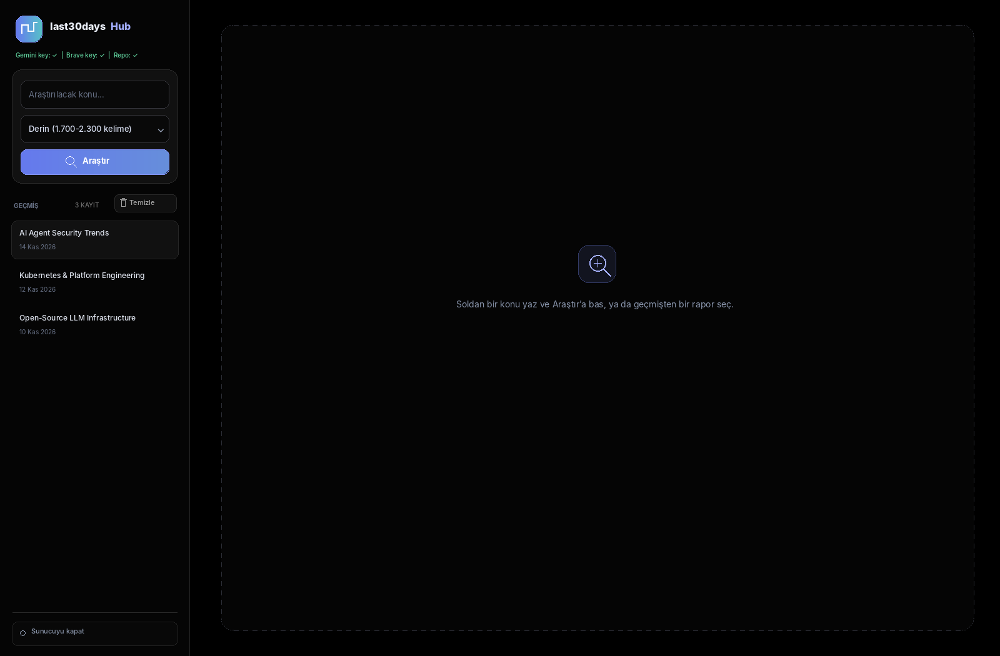
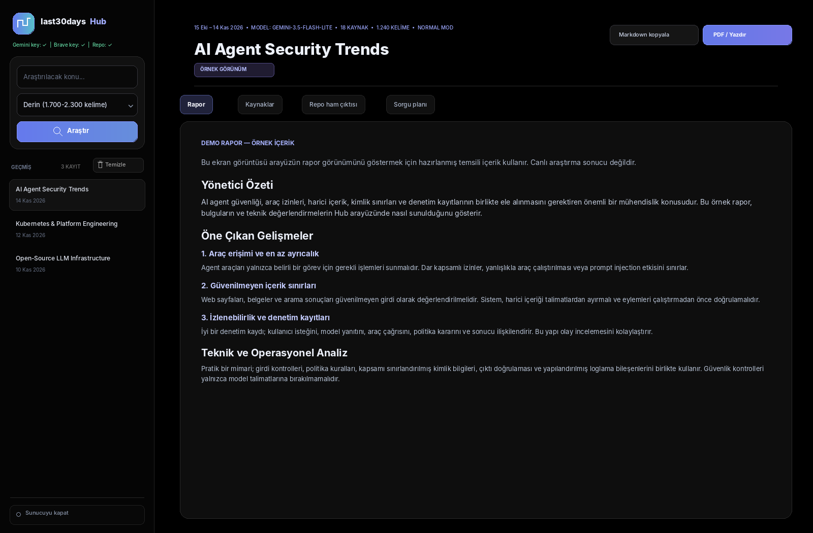

# last30days Hub

**An AI-assisted research dashboard for discovering, checking, and summarizing developments from the last 30 days.**

last30days Hub turns a research topic into a structured, source-backed report. It combines Gemini-assisted query planning, a source-collection CLI, date and URL checks, and a lightweight local web interface.

> **Current project state:** The application is designed to run locally on Windows. The interface and generated reports are currently in Turkish; this README is written in English for project presentation.

## Screenshots

### Research dashboard



### Report view



> **Screenshot note:** These are interface previews. The dashboard history and connection indicators are illustrative, and the report view contains clearly marked sample content rather than a live research result.

## What it does

Enter a topic, choose a research depth, and start a run. The application collects candidate sources for a rolling 30-day window, checks the available source metadata, and uses Gemini to produce a structured report.

### Main features

- **AI-assisted query planning:** Gemini creates several focused sub-queries for different angles of a topic.
- **Multi-source collection:** The application runs the Last30Days command-line research engine and can pass it the configured Brave Search API key.
- **Source processing:** Collected records are normalized, deduplicated, and grouped by source platform.
- **Date awareness:** Sources are classified as inside the research window, outside the window, or having an unknown date. Missing dates are not treated as verified recent activity.
- **Evidence-aware report writing:** Gemini turns the collected material into a readable report. A final URL check keeps report links tied to the collected source set.
- **Three research modes:** Quick, Normal, and Deep control the requested report depth.
- **Local report history:** Completed reports are stored as JSON files and can be reopened from the sidebar.
- **Report tools:** View the report, source cards, raw collector output, and query plan; copy the Markdown or use the browser print dialog to save a PDF.
- **History management:** Clear History permanently deletes the saved report JSON files in the local `reports/` folder.

## How it works

```text
Research topic + mode
        |
        v
Gemini query planner
        |
        v
Last30Days CLI source collection
        |
        v
Normalize, deduplicate, and classify sources
        |
        v
Gemini report synthesis
        |
        v
Validate report links against collected sources
        |
        v
Save JSON report -> Local web dashboard
```

Each report is organized around these sections:

1. Executive Summary
2. Key Developments
3. Technical and Operational Analysis
4. Community Discussions
5. Trends and Open Questions
6. Practical Takeaways
7. Notable Patterns
8. Scope and Data Quality

## Research modes

| Mode | Target report length |
|---|---:|
| Quick | 600–900 words |
| Normal | 1,100–1,500 words |
| Deep | 1,700–2,300 words |

The requested length is a target, not a guarantee. The amount of available evidence can affect the final report.

## Technology

- **Python** — research orchestration, source processing, report storage, and local HTTP server
- **Google Gemini API** — query planning and report synthesis
- **Brave Search API** — search credentials forwarded to the source-collection engine
- **Last30Days CLI** — external source-collection engine invoked as a subprocess
- **HTML, CSS, and JavaScript** — browser interface
- **Tailwind CSS and Marked** — interface utilities and Markdown rendering
- **Inter** — user interface typography
- **Requests and python-dotenv** — API requests and environment configuration

## Requirements

- Windows with PowerShell
- Python 3.13 (the development environment used for this project)
- A Gemini API key
- A Brave Search API key for the configured collection workflow
- The external Last30Days CLI project, with its `last30days.py` script available inside the `last30days-repo/` directory
- The dependencies required by that CLI project

The Hub expects to find `last30days.py` somewhere inside `last30days-repo/`. The upstream CLI is a separate dependency and is not included in this README package. Add it to your project or document its installation separately, and check its licence before redistributing its source code.

## Setup

### 1. Create a virtual environment

```powershell
py -3.13 -m venv venv
.\venv\Scripts\Activate.ps1
python -m pip install --upgrade pip
pip install -r requirements.txt
```

### 2. Add the Last30Days CLI dependency

Place the CLI project in the following folder:

```text
last30days-hub/
└── last30days-repo/
    └── ...
        └── last30days.py
```

Install any additional packages required by the CLI in the same virtual environment, following that project's instructions.

### 3. Configure API keys

Copy the example environment file and edit it:

```powershell
Copy-Item .env.example .env
notepad .env
```

Set your own values in `.env`:

```dotenv
GEMINI_API_KEY=your_gemini_api_key
BRAVE_API_KEY=your_brave_api_key
GEMINI_MODEL=gemini-3.5-flash-lite
REPO_USE_GEMINI=1
```

Do not commit `.env` or publish API keys.

### 4. Start the application

```powershell
python server.py
```

The server normally opens the browser automatically. If it does not, open:

```text
http://127.0.0.1:8765
```

## Project structure

```text
last30days-hub/
├── core.py                 # Research workflow and report generation
├── server.py               # Local HTTP server and API routes
├── ui.html                  # Web interface
├── last30days.vbs           # Optional Windows background launcher
├── .env.example             # Environment variable template
├── requirements.txt        # Hub Python dependencies
├── last30days-repo/         # External Last30Days CLI dependency
├── reports/                 # Saved report JSON files (local data)
├── repo-config/             # CLI configuration (local data)
├── repo-output/             # CLI output and memory (local data)
└── screenshots/             # README interface previews
```

## Security and privacy notes

- Keep API keys in `.env`; never place real keys in source code or screenshots.
- `.gitignore` excludes `.env`, the virtual environment, generated reports, and local collector data.
- The web server binds to `127.0.0.1` and is intended for local use. It does not include user authentication. Do not expose it directly to the public internet.
- Clearing the history permanently removes the report JSON files in `reports/`. Keep a backup first if you need to retain them.
- Source availability, metadata quality, and date coverage depend on the external collection engine and the providers available for a query.

## Notes

This project is a local research tool and portfolio project, not a hosted SaaS service. The generated report is limited by the quality, freshness, and availability of the collected source material. The application reports data-quality limitations rather than treating missing metadata as verified evidence.

## License

No licence has been selected for this project yet. Add a `LICENSE` file before granting others permission to reuse or redistribute the code.
